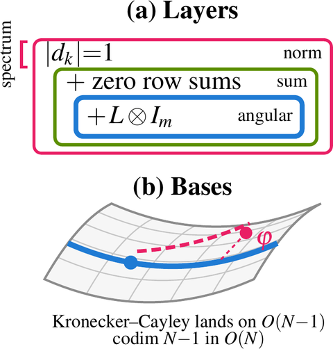

# Kronecker–Cayley
**Beyond Unit-Circle Eigenvalues: Invariant Bases for Stable State Space Dynamics**


<p align="center">
  <a href="assets/overview.png"></a>
</p>

## 🔍 What this is

The Kronecker-Cayley transition (KC) assembles the generator of a diagonal recurrence as a graph
Laplacian over object subspaces, H = L ⊗ I_m, and advances the latent by its Cayley transform. The
step stays diagonal, and it holds the summed quantity over subspaces together with a
2m²-dimensional family of quadratic forms at every parameter value, whereas a unit-modulus spectrum
holds only the norm.

- **KC mass drift 8.3e-3** on the dam break, **2.6e-3** on advection, **2.0e-5** on Allen–Cahn, against 3 to 2e11 for every diagonal baseline (levels B and C, free diagonal, LRU).
- **Linear momentum about 2e-6** on all three N-body systems (charged, gravity, spring) at a 1000-step rollout.
- **Zero-mode preserved to float32 round-off** at the transition itself (`tests/test_kc.py`).

## 🛠️ Installation

```bash
python -m venv .venv && source .venv/bin/activate
pip install -e .
pytest tests/
```

## 📋 Prerequisites

Python 3.10+, PyTorch 2.x (CUDA build for training; the tests run on CPU). The KC eigendecomposition
runs in float64 and the rollout in float32. A GPU is needed to train the grid and N-body models.
Reference hardware: NVIDIA RTX PRO 6000.

## 🗂️ Datasets

Public downloads: PDEBench (dam break, advection), PDEArena ShallowWater-2D (sphere), EGNN N-body
(charged, gravity, spring). Allen–Cahn is generated in-repo. All go under a `--data_root`.

```bash
bash data/download_public.sh DATA
python data/download_shallow_water_sphere.py DATA
python data/gen_allen_cahn.py --out_dir DATA
```

See `data/README.md` for source, split, size and seeds; `configs/` holds the Appendix A settings.

## 🔬 Training and evaluation

| Paper item | Script + command | Compute |
|---|---|---|
| Grid benchmarks (mass drift, nRMSE) | `python training/pde_grid_train.py <benchmark> <arm> <decoder> <seed> --data_root DATA` | ~3–7 min/run, 1 GPU |
| N-body conservation (momentum, energy drift) | `python training/nbody_train.py <system> <arm> <decoder> <seed> --data_root DATA` | ~2–7 min/run, 1 GPU |

`<arm>` ∈ `{kc, free, level_b, level_c, lru}`; `<decoder>` ∈ `{tied, tied_cos, unconstrained}`
(`tied_cos` on the sphere; `unconstrained` is KC with a free decoder). Seeds 42, 43, 44.

## 📁 Repository layout

```
kc/            KC transition and diagonal baselines
data/          download script for public benchmarks and the Allen–Cahn generator
configs/       experiment settings (Appendix A, Table 5)
training/      grid and N-body trainers
tests/         KC smoke tests
```

## 📄 Citation

```bibtex
@inproceedings{zhu2026kroneckercayley,
  title     = {Beyond Unit-Circle Eigenvalues: Invariant Bases for Stable State Space Dynamics},
  author    = {Zhu, Jiaqian and Zhang, Yang and Ding, Junhua and Yu, Xiaowei},
  booktitle = {Advances in Neural Information Processing Systems},
  year      = {2026}
}
```

Jiaqian Zhu (Missouri S&T) — project leader, code author and maintainer

## ⚖️ License

[MIT](LICENSE). Third-party data under their own licences (PDEBench CC BY 4.0, PDEArena MIT, EGNN MIT).
